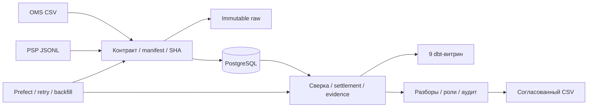

# CommerceGuard — как я довёл конвейер до информационной системы

[Полный исходный код v1.0.0](https://github.com/Decl1s/commerceguard/tree/v1.0.0) ·
[Релиз и архив](https://github.com/Decl1s/commerceguard/releases/tag/v1.0.0) ·
[Фактический CI](https://github.com/Decl1s/commerceguard/actions/runs/40409886361)

Я сделал самостоятельный портфельный проект на синтетических данных: сверку заказов,
платежей, возвратов и settlement с рабочим местом для разбора расхождений.
Здесь я объясняю задачу и принятые решения; команды и подробные контракты оставляю
в документации самого приложения.

## Какую проблему я моделирую

В OMS и платёжной системе могут отличаться сумма, статус или время появления факта.
Поздний возврат меняет картину уже после первой сверки. Специалисту нужно понять,
из каких событий сложилась сумма, что изменилось и какое решение уже было принято.
Я построил путь от исходного файла до такого объяснения, а не только итоговую сумму.

## Как устроено моё решение

| Решение | Почему я его принял |
| --- | --- |
| Я сохраняю immutable raw и связь с manifest | Могу объяснить происхождение факта и проверить повтор |
| Я различаю факт, наблюдение и время доступности | Позднее событие не должно незаметно переписать прежний результат |
| Я фиксирую run/result/evidence | Повторное чтение результата не зависит от изменившегося latest |
| Я разделяю системное расхождение и человеческое решение | Исчезнувшее расхождение не закрывает разбор автоматически |
| Я предварительно агрегирую данные перед join | Возвраты не размножают суммы в аналитических моделях |
| Я ограничиваю retry и проверяю resume | Оркестратор продолжает подтверждённые шаги без выдуманной общей транзакции |
| Я проверяю restore в другой кластер | Наличие файла backup само по себе не доказывает восстановление |

## Что я могу показать за 5–10 минут

1. Я открываю синтетическую очередь расхождений и выбираю один разбор.
2. Я показываю источники суммы и evidence, затем назначение, комментарий и решение.
3. Я повторяю входной пакет: второй комплект бизнес-фактов не появляется.
4. Я разбираю позднюю корректировку и сохранённый прежний результат.
5. Я открываю dbt-модель, её зерно и проверку, затем результат CI и restore-сценарий.

[Сценарий демонстрации](https://github.com/Decl1s/commerceguard/blob/v1.0.0/docs/DEMO.md),
[руководство и упражнения](https://github.com/Decl1s/commerceguard/blob/v1.0.0/docs/HANDBOOK.md),
[карта модулей](https://github.com/Decl1s/commerceguard/blob/v1.0.0/docs/PROJECT_MAP.md).

## Какие проверки я действительно выполнил

Для выпуска 1.0.0 я подтвердил 99 unit-тестов в трёх runtime-профилях, PostgreSQL
integration, 9 dbt-моделей / 19 data tests, Prefect retry/resume, браузерный сценарий,
Compose-перезапуски и восстановление backup. Конкретные условия и результаты:
[VALIDATION](https://github.com/Decl1s/commerceguard/blob/v1.0.0/VALIDATION.md),
[матрица выпуска](https://github.com/Decl1s/commerceguard/blob/v1.0.0/docs/RELEASE_CHECKLIST.md),
[CI окончательного коммита](https://github.com/Decl1s/commerceguard/actions/runs/40409886361).

## Что я ограничил сознательно

Я проверил одну организацию, Linux x86_64 и локальный Docker Compose. Сервера и
домена пока нет. Подготовку будущего HTTPS веду отдельно от неизменяемого v1.0.0.
Не заявляю реальные банковские тарифы, внешнего клиента, HA, SSO, произвольную нагрузку
или промышленную эксплуатацию. Учебная политика расчёта и поддержанный профиль
явно описаны в документации.

## Что я готов обсудить на техническом интервью

- Как я выбираю бизнес-ключ и отделяю повтор от конфликтующего события.
- Где проходит транзакция загрузки и почему файловая запись не равна COMMIT в БД.
- Как я избегаю fan-out и смешения валют в SQL.
- Почему исправленный отчёт не подменяет исторический результат.
- Что проверяют роли, CSRF, optimistic concurrency и неизменяемый аудит.
- Почему я выбрал PostgreSQL, dbt, Prefect и обычный Docker Compose для этого объёма.

[Назад к профилю](https://github.com/Decl1s) · [Все проекты](PROJECTS.md)
